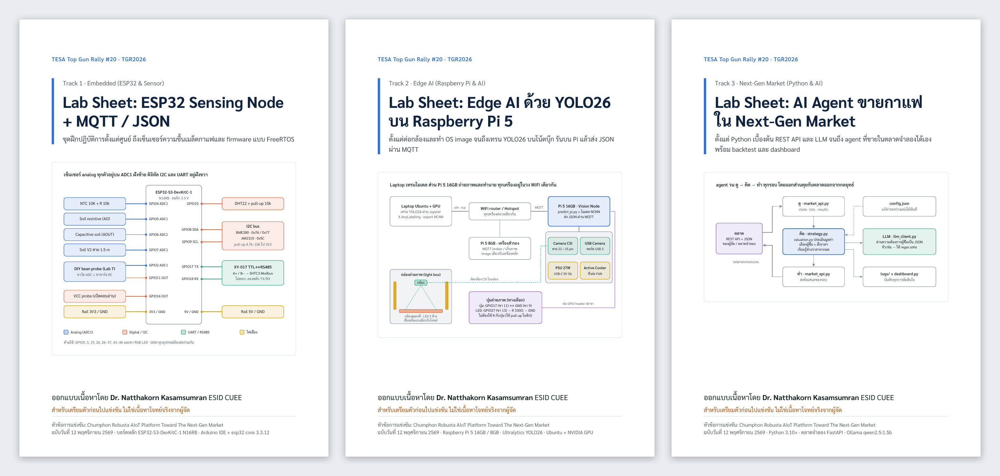

# TGR2026 Lab Sheets · ชุดฝึกเตรียมแข่ง TESA Top Gun Rally #20

ชุดฝึกปฏิบัติการ 3 Track สำหรับเตรียมตัวก่อนไปแข่ง **TESA Top Gun Rally #20 (TGR2026)**
หัวข้อการแข่งขัน: *Chumphon Robusta AIoT Platform Toward The Next-Gen Market*



Preparation lab sheets and source code for the three tracks of TGR2026: Embedded (ESP32), Edge AI (Raspberry Pi + YOLO26) and AI Agent (Python + LLM).

> [!IMPORTANT]
> เนื้อหานี้ **สำหรับเตรียมตัวก่อนไปแข่งขัน ไม่ใช่เนื้อหาโจทย์จริงจากผู้จัด**
> ตลาดจำลอง สูตรมูลค่า ผู้ซื้อ API และรูปแบบข้อมูลในชุดฝึกเป็นการคาดเดาจากสไลด์ Pre-Camp เท่านั้น

ออกแบบเนื้อหาโดย **อาจารย์ ดร.ณัทกร เกษมสำราญ (Dr. Natthakorn Kasamsumran)** ESID CUEE · ฉบับวันที่ 12 พฤศจิกายน 2569

---

## สารบัญ

| Track | หัวข้อ | Lab Sheet | โค้ด |
|---|---|---|---|
| 1 · Embedded | ESP32-S3 Sensing Node + MQTT / JSON | [PDF (57 หน้า)](track1-embedded-esp32/TGR2026_Track1_LabSheet.pdf) | [`track1-embedded-esp32/code`](track1-embedded-esp32/code) |
| 2 · Edge AI | YOLO26 บน Raspberry Pi 5 ส่ง JSON ผ่าน MQTT | [PDF (33 หน้า)](track2-edge-ai-raspberrypi/TGR2026_Track2_LabSheet.pdf) | [`track2-edge-ai-raspberrypi/tgr_vision`](track2-edge-ai-raspberrypi/tgr_vision) |
| 3 · Next-Gen Market | AI Agent ขายกาแฟในตลาดจำลอง (Python + LLM) | [PDF (24 หน้า)](track3-ai-agent-market/TGR2026_Track3_LabSheet.pdf) | [`track3-ai-agent-market/tgr_market`](track3-ai-agent-market/tgr_market) |

ในแต่ละ PDF มีไฟล์โค้ดแนบอยู่ด้วย (เปิดได้ใน Adobe Acrobat Reader) แต่ **แนะนำให้ใช้โค้ดจาก repo นี้** เพราะโปรแกรมอ่าน PDF บางตัวตัดช่องว่างหน้าบรรทัดทิ้ง ทำให้ Python, YAML และ systemd ใช้ไม่ได้ โค้ดใน repo นี้ตรงกับไฟล์แนบใน PDF ทุกไบต์

## ระบบรวมของ 3 Track

```
 Track 1 · ESP32-S3                Track 2 · Raspberry Pi 5             Track 3 · AI Agent
 เซ็นเซอร์ความชื้น/อุณหภูมิ   ──┐      YOLO26n-seg (NCNN)              REST API ตลาด + LLM
 ความชื้นเมล็ด (sample_id)     │      นับเมล็ดต่อคลาส (lot_id)    ┌──▶ ประเมินมูลค่า ตั้งราคา
                              ▼                │                │
                        MQTT Broker ◀──────────┘ ───────────────┘
                     tgr2026/<team>/...
```

สัญญาข้อมูล (data contract) ที่ชุดฝึกใช้ร่วมกัน:

| Topic | ผู้ส่ง | เนื้อหา |
|---|---|---|
| `tgr2026/<team>/<device>/data` | Track 1 | ค่าจากเซ็นเซอร์เป็น JSON |
| `tgr2026/<team>/<device>/cmd` | ใครก็ได้ → ESP32 | เช่น `{"cmd":"measure","sample_id":"lot-A"}` |
| `tgr2026/<team>/vision/cmd` | Track 3 / คน → Pi | `{"cmd":"capture","lot_id":"A"}` |
| `tgr2026/<team>/vision/result` | Track 2 | `counts`, `total`, `defect_ratio`, `mean_conf`, `image_label` ฯลฯ |
| `tgr2026/<team>/vision/status` | Track 2 (retain + LWT) | `{"online":true}` / `false` |

ให้ Track 1 ใช้ `sample_id` และ Track 2 ใช้ `lot_id` เป็นค่าเดียวกัน Agent ของ Track 3 จะรวมความชื้นกับคุณภาพของล็อตเดียวกันได้ทันที

---

## Track 1 · Embedded (ESP32 & Sensor)

บอร์ดหลัก **ESP32-S3-DevKitC-1 N16R8** · Arduino IDE + esp32 core 3.3.12 · MQTT Broker (Mosquitto หรือ EMQX)

| Lab | เนื้อหา | Sketch |
|---|---|---|
| 0 | ติดตั้งเครื่องมือและ MQTT Broker | `mosquitto_tgr.conf`, `commands.sh` |
| 1 | รู้จักบอร์ด ESP32-S3, Pin Map และการต่อสายไฟ | `Lab00_RGB_Test`, `Lab01_BoardCheck` |
| 2 | WiFi + MQTT + JSON (แกนหลักของทุก Lab) | `Lab02_MQTT_JSON_Template` |
| 3 | เซ็นเซอร์ Analog, การกรองสัญญาณ และ Calibration | `Lab03_Analog_Test`, `Lab03_Analog_MQTT` |
| 4 | DHT22 | `Lab04_DHT22_Test`, `Lab04_DHT22_MQTT` |
| 5 | I2C ด้วย BME280, AM2315 และ Logic Level Converter | `Lab05_I2C_Scanner`, `Lab05_I2C_Test` |
| 6 | RS485 Modbus RTU กับ SHTC3 ผ่าน XY-017 | `Lab06_Modbus_Scan`, `Lab06_Modbus_MQTT` |
| 7 | เซ็นเซอร์ความชื้นเมล็ดกาแฟ DIY และ Calibrate | `Lab07_BeanMoisture_MQTT`, `python/calibration_fit.py` |
| 8 | รวมระบบด้วย FreeRTOS (ซ้อมวัน Integration) | `Lab08_Integration_RTOS` |

**เริ่มต้น:** เปิด `code/LabXX_.../LabXX_....ino` ด้วย Arduino IDE แล้วตั้งค่าบอร์ด
`ESP32S3 Dev Module` · Flash 16MB · PSRAM `OPI PSRAM` · Partition `16M Flash (3MB APP/9.9MB FATFS)`
จากนั้นแก้ส่วน "ตั้งค่า" ด้านบนของ sketch (`WIFI_SSID`, `WIFI_PASS`, `MQTT_HOST`, `TEAM`) ก่อนอัปโหลดทุกครั้ง

Library ที่ทดสอบคอมไพล์แล้ว: PubSubClient 2.8, ArduinoJson 7.4.2, DHT sensor library 1.4.7, Adafruit BME280 2.3.0, Adafruit AM2315 2.2.3, Adafruit BusIO 1.17.4, Adafruit Unified Sensor 1.1.15

ภาคผนวกของ PDF มีวิธีย้ายโค้ดไปใช้กับ FireBeetle 2 ESP32-P4

## Track 2 · Edge AI (Raspberry Pi & AI)

Raspberry Pi 5 (16GB หลัก / 8GB สำรอง) · Ultralytics YOLO26 · โน้ตบุ๊ก Ubuntu + NVIDIA GPU สำหรับเทรน

| Lab | เนื้อหา |
|---|---|
| 0–2 | ฮาร์ดแวร์ กล้อง CSI/USB, OS image + SSH, คำสั่ง Linux และ tmux |
| 3 | ติดตั้ง Ubuntu (dual boot) และสภาพแวดล้อมเทรน YOLO26 |
| 4 | ติดตั้ง YOLO26 บน Pi, export NCNN และวัดความเร็ว |
| 5 | เก็บภาพเองและ label ด้วย X-AnyLabeling (SAM) |
| 6 | ซ้อมวันที่ 1: Classification (ตัดเมล็ดอัตโนมัติ + โหวต) |
| 7 | ซ้อมวันที่ 2: Detection / Segmentation ด้วย YOLO26n-seg + กองเมล็ดสังเคราะห์ |
| 8 | ซ้อมวันที่ 3: Integration บน Pi ส่ง JSON ผ่าน MQTT + systemd |

```bash
# โน้ตบุ๊ก (รอบแรกติดตั้งไดรเวอร์ NVIDIA → รีบูต → รันซ้ำ)
cp -r track2-edge-ai-raspberrypi/tgr_vision ~/tgr_vision
cd ~/tgr_vision && bash setup_laptop.sh

# Raspberry Pi
scp -r ~/tgr_vision pi@tgr-vision.local:~/
ssh pi@tgr-vision.local "cd ~/tgr_vision && bash setup_pi.sh"
```

| ไฟล์ | หน้าที่ |
|---|---|
| `train_yolo26.ipynb` | ขั้นตอนเทรนทั้งหมดใน Jupyter (kernel `Python (tgr)`) |
| `bean_extract.py` | ตัดเมล็ดอัตโนมัติจากภาพ 1 คลาสต่อภาพ → crop / polygon / cutout |
| `synth_piles.py` | สร้างกองเมล็ดสังเคราะห์พร้อม label YOLO-seg |
| `convert_labels.py` | แปลง JSON ของ X-AnyLabeling / LabelMe เป็น YOLO |
| `count_eval.py` | วัดความคลาดเคลื่อนของการนับต่อคลาสและสัดส่วนเมล็ดเสีย |
| `camera.py`, `capture.py` | เปิดกล้อง CSI/USB ล็อกแสงและ white balance, ถ่ายเก็บ dataset |
| `predict_pi.py` | ทำนาย → นับต่อคลาส → JSON → MQTT (โฟลเดอร์ภาพ / กล้อง / รอคำสั่ง) |
| `benchmark_pi.py` | วัดความเร็วโมเดลบน Pi |
| `examples/` | `day2_mix.yaml`, `day3_mix.yaml`, `tgr-vision.service`, `gpio_button.py` |

ไม่มี weight หรือ dataset ใน repo นี้ ไฟล์ `yolo26n-*.pt` จะดาวน์โหลดอัตโนมัติเมื่อรันครั้งแรก

## Track 3 · Next-Gen Market (Python & AI)

Python 3.10+ · ตลาดจำลอง FastAPI · LLM แบบ OpenAI-compatible (ซ้อมด้วย Ollama `qwen2.5:1.5b`)

| Lab | เนื้อหา |
|---|---|
| 0–1 | ติดตั้ง Python, VS Code และ Python เท่าที่ agent ต้องใช้ |
| 2 | REST API + JSON และซ้อมขายด้วยมือ (ซ้อมวันที่ 17) |
| 3 | LLM บนเครื่องด้วย Ollama และ client ที่สลับไปใช้ของผู้จัดได้ |
| 4 | Starter agent และวงจร ดู–คิด–ทำ |
| 5 | กลยุทธ์ ประเมินมูลค่า จับคู่ผู้ซื้อ ปรับราคา + backtest (ซ้อมวันที่ 18) |
| 6 | ซ้อมวันแข่งจริง: กันพัง, log, แก้ค่าระหว่างแข่ง, dashboard (วันที่ 20) |

```bash
cd track3-ai-agent-market/tgr_market
python -m venv venv
source venv/bin/activate            # Windows: venv\Scripts\Activate.ps1
pip install -r requirements.txt

# หน้าต่างที่ 1: ตลาดจำลอง → http://127.0.0.1:8000 (เอกสาร API ที่ /docs)
python market_sim/server.py --teams team_a,team_b --rounds 10 --round-seconds 10 --seed 3

# หน้าต่างที่ 2: starter agent (team_b)
cd agent && python starter_agent.py --team team_b --token token-team_b

# หน้าต่างที่ 3: agent ของชุดฝึก (team_a, ค่าใน agent/config.json)
cd agent && python agent.py

# วัดผลกลยุทธ์แบบออฟไลน์ / เปิด dashboard
python backtest.py --games 40
cd agent && streamlit run dashboard.py
```

วันที่ 17 เมื่อเห็น API จริง ให้แก้แค่ `agent/market_api.py` และสูตร `estimate_value()` ใน `agent/valuation.py` ส่วนค่าที่ปรับได้ทั้งหมดอยู่ใน `agent/config.json` และแก้ระหว่างแข่งได้โดยไม่ต้องหยุด agent

---

## สถานะการทดสอบ (12 พ.ย. 2569)

| Track | ทดสอบรันจริงแล้ว | ยังต้องทดสอบบนเครื่องจริง |
|---|---|---|
| 1 | คอมไพล์ผ่านทั้ง 13 sketch | ทดสอบกับฮาร์ดแวร์และเซ็นเซอร์จริงตามเช็คพอยต์ใน PDF |
| 2 | `bean_extract.py`, `synth_piles.py`, `convert_labels.py`, `count_eval.py` (กับภาพจำลอง) | `predict_pi.py`, `camera.py`, `capture.py`, `benchmark_pi.py`, notebook และสคริปต์ติดตั้ง (ตรวจ syntax แล้ว) |
| 3 | ตลาดจำลอง, agent (รวมการรีสตาร์ตกลางเกม), starter, backtest, dashboard, basics | การเรียก Ollama จริงและ LLM ของผู้จัด (ทดสอบกับเซิร์ฟเวอร์จำลองแบบ OpenAI-compatible แล้ว) |

## ค่าตัวอย่างที่ต้องเปลี่ยนก่อนใช้งาน

โค้ดใช้ค่าตัวอย่างเดียวกับใน PDF ไม่มีรหัสผ่านหรือ key จริงอยู่ใน repo นี้

| ค่า | ค่าตัวอย่าง | อยู่ที่ |
|---|---|---|
| WiFi | `TGR_TEAM` / `12345678` | Track 1 sketch ที่ส่ง MQTT |
| MQTT broker | `192.168.1.50` | Track 1 sketch, `commands.sh`, `python/mqtt_subscriber.py`, Track 2 `tgr-vision.service` |
| ชื่อทีม | `kmitl01` | Track 1 sketch, Track 2 `predict_pi.py --team` |
| Token ตลาดจำลอง | `token-team_a` | Track 3 `agent/config.json` (ใช้กับตลาดจำลองในเครื่องเท่านั้น) |
| LLM | `http://127.0.0.1:11434/v1` · `qwen2.5:1.5b` | Track 3 `agent/config.json` ส่วน `llm` |

> [!WARNING]
> เมื่อใส่ค่าจริงของทีม (รหัส WiFi, API key ของ LLM ผู้จัด) ห้าม commit กลับขึ้น repo สาธารณะ

## โครงสร้าง repo

```
TGR2026/
├── README.md
├── LICENSE                MIT (โค้ด)
├── LICENSE-docs.md        CC BY 4.0 (PDF)
├── track1-embedded-esp32/
│   ├── TGR2026_Track1_LabSheet.pdf
│   └── code/              Arduino sketch (Lab00–Lab08), python/, commands.sh, mosquitto_tgr.conf
├── track2-edge-ai-raspberrypi/
│   ├── TGR2026_Track2_LabSheet.pdf
│   └── tgr_vision/        สคริปต์เทรน/ทำนาย YOLO26, notebook, setup scripts, examples/
└── track3-ai-agent-market/
    ├── TGR2026_Track3_LabSheet.pdf
    └── tgr_market/        ตลาดจำลอง, agent, backtest, basics/
```

## สัญญาอนุญาต (License)

| ส่วน | สัญญาอนุญาต | ไฟล์ |
|---|---|---|
| โค้ดทั้งหมด (`.ino`, `.py`, `.sh`, `.ipynb`, `.yaml`, `.json`, `.html`, `.service`, `.conf`) | MIT | [`LICENSE`](LICENSE) |
| Lab Sheet PDF ทั้ง 3 Track | CC BY 4.0 | [`LICENSE-docs.md`](LICENSE-docs.md) |

นำไปใช้ แก้ไข และเผยแพร่ต่อได้ รวมถึงใช้สอนหรือใช้ในชมรม/ทีมอื่น โดยให้เครดิตผู้ออกแบบเนื้อหา

## เครดิต

ออกแบบเนื้อหาและโค้ดโดย 
อาจารย์ ดร.ณัทกร เกษมสำราญ ภาควิชาวิศวกรรมไฟฟ้า คณะวิศวกรรมศาสตร์ จุฬาลงกรณ์มหาวิทยาลัย
Dr. Natthakorn Kasamsumran, ESID, Department of Electrical Engineering, Faculty of Engineering, Chulalongkorn University
จัดทำเพื่อเตรียมนิสิตสำหรับการแข่งขัน TESA Top Gun Rally #20 (TGR2026)
